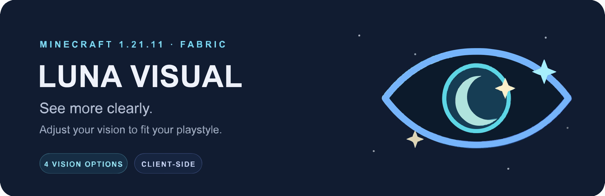
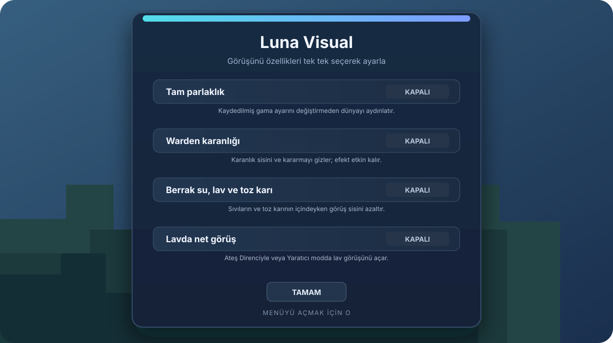

<div align="center">
  
  <br />
  
  
  
  
</div>

**Luna Visual** is a client-side Fabric mod for Minecraft Java Edition that brings four different visual enhancement features together in one clean, simple settings screen. You can independently enable or disable each feature according to your preferences.

## ✨ Features

| Feature | Description |
| --- | --- |
| **Full Brightness** | Brightens dark areas without modifying Minecraft's saved gamma settings. |
| **Warden Darkness** | Hides the visual fog and darkening effects caused by the Darkness effect. The gameplay effects of Darkness remain unchanged. |
| **Clear Water, Lava, and Powder Snow** | Reduces visual fog while submerged in water or lava, or while inside powder snow. |
| **Clear Lava Vision** | Reduces lava fog and lowers the fire overlay when in Creative Mode or under the effects of Fire Resistance. |



*An illustrative preview of the settings screen. Each feature can be configured independently and is disabled by default.*

## 📥 Installation

1. Create a Fabric profile for **Minecraft Java Edition 1.21.11**.
2. Install Fabric Loader and a version of Fabric API compatible with Minecraft 1.21.11.
3. Download the Luna Visual JAR file from the **Releases** section of this repository. If no release is available yet, follow the build instructions below.
4. Place the JAR file in the `mods` folder of your Minecraft installation and launch the game using your Fabric profile.

Luna Visual runs entirely on the client and does not need to be installed on the server. Make sure you do not have multiple versions of Luna Visual in the same `mods` folder.

## 🎮 Usage

- Press **O** to open the Luna Visual settings screen.
- Toggle features on or off using the buttons on the screen. Changes are saved automatically.
- Close the screen using the **Done** button or the **Escape** key.
- You can change the keybind under **Options → Controls → Key Binds → Luna Visual**.

Configuration file: `config/lunavisual.properties`

## 🧩 Requirements

- Minecraft Java Edition **1.21.11**
- Fabric Loader **0.18.1 or newer**
- Fabric API **0.141.1+1.21.11 or newer**
- Java **21 or newer**

## 🛠️ Building from Source

Java 21 must be installed. Run the Gradle Wrapper from the project directory.

**Windows:**

```powershell
.\gradlew.bat remapJar
```

**macOS / Linux:**

```shell
./gradlew remapJar
```

The distributable JAR file will be generated in the `build/libs/` directory.

## 📄 License

Luna Visual's code and visual assets are distributed under the [MIT License](LICENSE).
