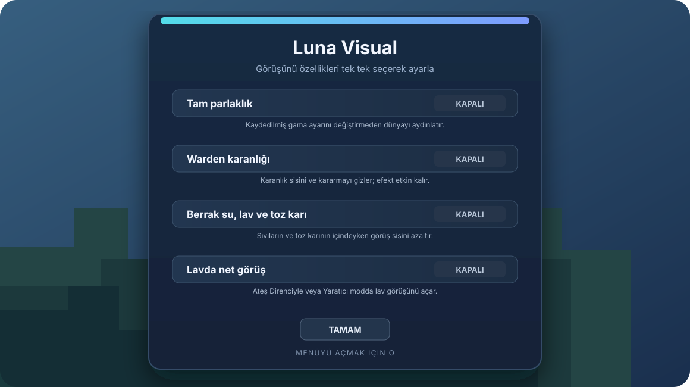

<div align="center">
  
  <br />
  
  
  
  
</div>

**Luna Visual**, Minecraft Java Edition için hazırlanmış, istemci tarafında çalışan bir Fabric modudur. Dört farklı görüş özelliğini tek, sade bir ayar ekranında toplar. İstediğin seçenekleri ayrı ayrı açıp kapatabilirsin.

## ✨ Özellikler

| Özellik | Ne yapar? |
| --- | --- |
| **Tam parlaklık** | Karanlık alanları aydınlatır; Minecraft’ta kaydedilmiş gama ayarını değiştirmez. |
| **Warden karanlığı** | Karanlık efektinin görsel sisini ve kararmasını gizler. Efektin oyun içi etkisi devam eder. |
| **Berrak su, lav ve toz karı** | Su, lav veya toz karının içindeyken görüş sisini azaltır. |
| **Lavda net görüş** | Yaratıcı modda veya Ateş Direnci etkisi altındayken lav sisini azaltır ve ateş görüntüsünü aşağı çeker. |



*Ayar ekranının temsili önizlemesi. Her seçenek bağımsızdır ve varsayılan olarak kapalıdır.*

## 📥 Kurulum

1. **Minecraft Java Edition 1.21.11** için Fabric profili oluştur.
2. Fabric Loader ve Minecraft 1.21.11 ile uyumlu Fabric API’yi kur.
3. Bu depodaki **Releases** bölümünden Luna Visual JAR dosyasını indir. Henüz sürüm yayımlanmadıysa aşağıdaki derleme adımlarını kullan.
4. JAR dosyasını kullandığın Minecraft profilinin `mods` klasörüne koyup Fabric profiliyle oyunu başlat.

Mod yalnızca istemcide çalışır; sunucuya kurulması gerekmez. Aynı `mods` klasöründe Luna Visual’ın birden fazla sürümünü birlikte bırakma.

## 🎮 Kullanım

- **O** tuşuna basarak Luna Visual ayar ekranını aç.
- Özellikleri ekrandaki düğmelerle açıp kapat. Değişiklikler otomatik kaydedilir.
- Ekranı **Tamam** düğmesiyle veya **Escape** tuşuyla kapat.
- Tuş atamasını **Seçenekler → Kontroller → Tuş Atamaları → Luna Visual** bölümünden değiştirebilirsin.

Ayar dosyası: `config/lunavisual.properties`

## 🧩 Gereksinimler

- Minecraft Java Edition **1.21.11**
- Fabric Loader **0.18.1 veya üzeri**
- Fabric API **0.141.1+1.21.11 veya üzeri**
- Java **21 veya üzeri**

## 🛠️ Kaynaktan derleme

Java 21 kurulu olmalı. Proje klasöründe Gradle Wrapper’ı çalıştır:

Windows:

```powershell
.\gradlew.bat remapJar
```

macOS / Linux:

```shell
./gradlew remapJar
```

Dağıtılabilir JAR dosyası `build/libs/` klasöründe oluşur.

## 📄 Lisans

Luna Visual’ın kodu ve görselleri [MIT Lisansı](LICENSE) ile yayımlanır.
